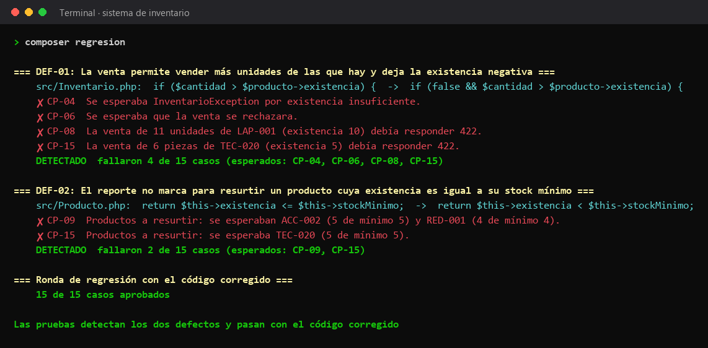

# Regresión con defectos inyectados

Para comprobar que las pruebas sí detectan errores, el script [`scripts/simular-defectos.php`](../../scripts/simular-defectos.php) copia `src/` a una carpeta temporal, mete un defecto a la vez y corre los 15 casos contra esa copia. El código real no se modifica.



## Defectos

| Defecto | Prioridad | Cambio que se inyecta | Casos que deben fallar | Resultado |
|---|---|---|---|---|
| DEF-01 La venta permite vender más unidades de las que hay | Alta | `src/Inventario.php` deja de validar la existencia antes de vender | CP-04, CP-06, CP-08, CP-15 | Detectado: fallaron los 4 |
| DEF-02 El reporte no marca un producto que quedó justo en su mínimo | Media | `src/Producto.php` cambia `<=` por `<` al decidir si hay que resurtir | CP-09, CP-15 | Detectado: fallaron los 2 |

Con el código corregido pasan los 15 de 15 casos.

## Evidencia de cada ronda

- [`DEF-01/`](DEF-01) y [`DEF-02/`](DEF-02): resultado JUnit de la ronda con cada defecto.
- [`corregido/`](corregido): resultado JUnit de la ronda con el código corregido.
- [`resumen.md`](resumen.md) y [`resumen.json`](resumen.json): tabla de resultados que genera el script.

## Cómo correrla

```bash
composer regresion
```

GitHub Actions corre esta misma regresión en cada push (trabajo `regresion-defectos`).
