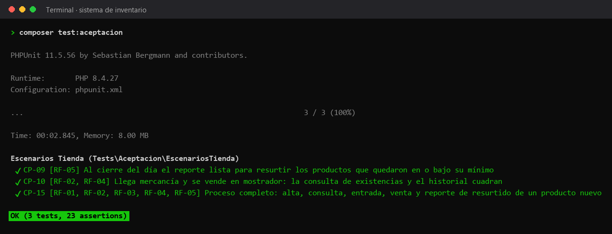

# Pruebas de aceptación

Recorren escenarios de la tienda de principio a fin para confirmar que el sistema cumple lo que pidió el usuario.



## Casos

| Caso | Requisito | Qué comprueba | Archivo |
|---|---|---|---|
| CP-09 | RF-05 | Al cierre del día el reporte lista para resurtir los productos que quedaron en o bajo su mínimo | [EscenariosTiendaTest.php](EscenariosTiendaTest.php) |
| CP-10 | RF-02, RF-04 | Llega mercancía y se vende en mostrador: la consulta de existencias y el historial cuadran | [EscenariosTiendaTest.php](EscenariosTiendaTest.php) |
| CP-15 | RF-01, RF-02, RF-03, RF-04, RF-05 | Proceso completo: alta, consulta, entrada, venta y reporte de resurtido de un producto nuevo | [EscenariosTiendaTest.php](EscenariosTiendaTest.php) |

## Cómo correrlas

Desde la raíz del proyecto, con las dependencias instaladas (`composer install`):

```bash
composer test:aceptacion
```

La imagen es la salida real de ese comando. El reporte HTML de la última ejecución en GitHub Actions está publicado en [https://azharsonix.github.io/sistema-inventario-actividad-2/](https://azharsonix.github.io/sistema-inventario-actividad-2/).
