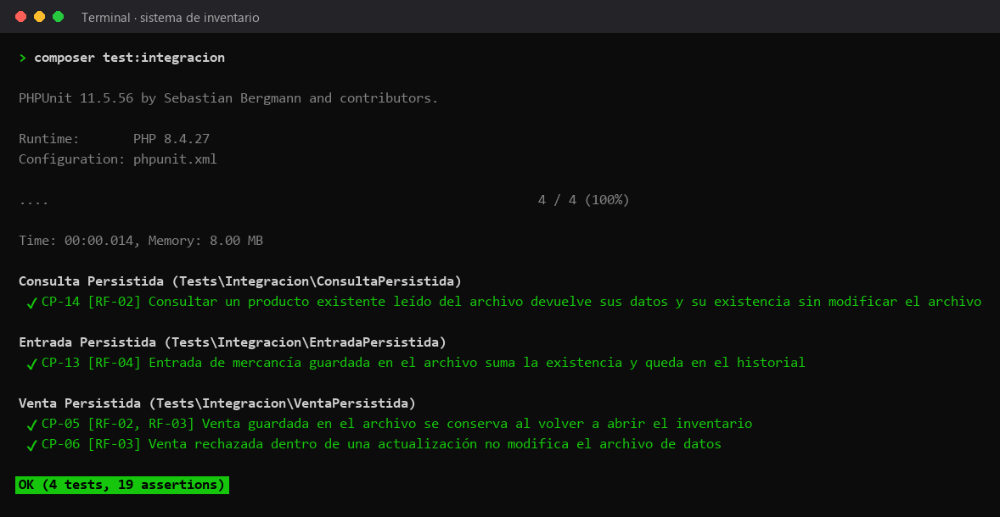

# Pruebas de integración

Prueban el inventario junto con `RepositorioInventario`, que guarda los datos en JSON: cada caso escribe en un archivo temporal y lo vuelve a leer.



## Casos

| Caso | Requisito | Qué comprueba | Archivo |
|---|---|---|---|
| CP-14 | RF-02 | Consultar un producto existente leído del archivo devuelve sus datos y su existencia sin modificar el archivo | [ConsultaPersistidaTest.php](ConsultaPersistidaTest.php) |
| CP-13 | RF-04 | Entrada de mercancía guardada en el archivo suma la existencia y queda en el historial | [EntradaPersistidaTest.php](EntradaPersistidaTest.php) |
| CP-05 | RF-02, RF-03 | Venta guardada en el archivo se conserva al volver a abrir el inventario | [VentaPersistidaTest.php](VentaPersistidaTest.php) |
| CP-06 | RF-03 | Venta rechazada dentro de una actualización no modifica el archivo de datos | [VentaPersistidaTest.php](VentaPersistidaTest.php) |

## Cómo correrlas

Desde la raíz del proyecto, con las dependencias instaladas (`composer install`):

```bash
composer test:integracion
```

La imagen es la salida real de ese comando. El reporte HTML de la última ejecución en GitHub Actions está publicado en [https://azharsonix.github.io/sistema-inventario-actividad-2/](https://azharsonix.github.io/sistema-inventario-actividad-2/).
