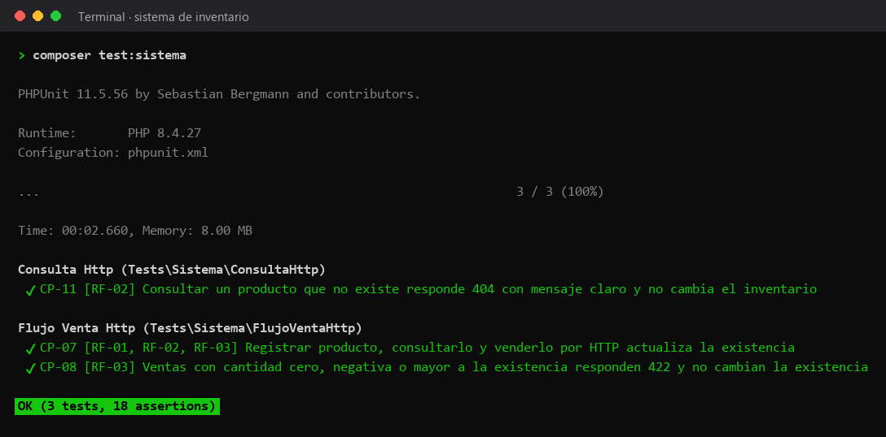

# Pruebas de sistema

Levantan el servidor embebido de PHP y prueban la API completa por HTTP, como lo haría un cliente.



## Casos

| Caso | Requisito | Qué comprueba | Archivo |
|---|---|---|---|
| CP-11 | RF-02 | Consultar un producto que no existe responde 404 con mensaje claro y no cambia el inventario | [ConsultaHttpTest.php](ConsultaHttpTest.php) |
| CP-07 | RF-01, RF-02, RF-03 | Registrar producto, consultarlo y venderlo por HTTP actualiza la existencia | [FlujoVentaHttpTest.php](FlujoVentaHttpTest.php) |
| CP-08 | RF-03 | Ventas con cantidad cero, negativa o mayor a la existencia responden 422 y no cambian la existencia | [FlujoVentaHttpTest.php](FlujoVentaHttpTest.php) |

## Cómo correrlas

Desde la raíz del proyecto, con las dependencias instaladas (`composer install`):

```bash
composer test:sistema
```

La imagen es la salida real de ese comando. El reporte HTML de la última ejecución en GitHub Actions está publicado en [https://azharsonix.github.io/sistema-inventario-actividad-2/](https://azharsonix.github.io/sistema-inventario-actividad-2/).
