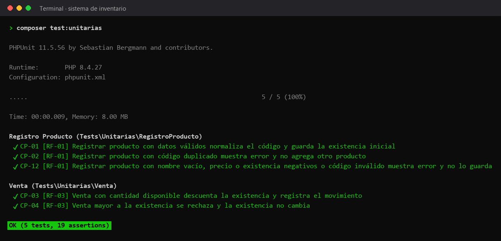

# Pruebas unitarias

Prueban las clases del dominio (`Inventario` y `Producto`) en memoria, sin archivo de datos ni servidor.



## Casos

| Caso | Requisito | Qué comprueba | Archivo |
|---|---|---|---|
| CP-01 | RF-01 | Registrar producto con datos válidos normaliza el código y guarda la existencia inicial | [RegistroProductoTest.php](RegistroProductoTest.php) |
| CP-02 | RF-01 | Registrar producto con código duplicado muestra error y no agrega otro producto | [RegistroProductoTest.php](RegistroProductoTest.php) |
| CP-12 | RF-01 | Registrar producto con nombre vacío, precio o existencia negativos o código inválido muestra error y no lo guarda | [RegistroProductoTest.php](RegistroProductoTest.php) |
| CP-03 | RF-03 | Venta con cantidad disponible descuenta la existencia y registra el movimiento | [VentaTest.php](VentaTest.php) |
| CP-04 | RF-03 | Venta mayor a la existencia se rechaza y la existencia no cambia | [VentaTest.php](VentaTest.php) |

## Cómo correrlas

Desde la raíz del proyecto, con las dependencias instaladas (`composer install`):

```bash
composer test:unitarias
```

La imagen es la salida real de ese comando. El reporte HTML de la última ejecución en GitHub Actions está publicado en [https://azharsonix.github.io/sistema-inventario-actividad-2/](https://azharsonix.github.io/sistema-inventario-actividad-2/).
